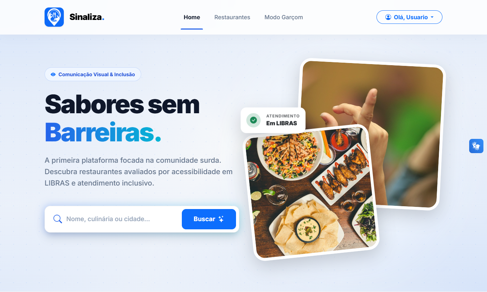
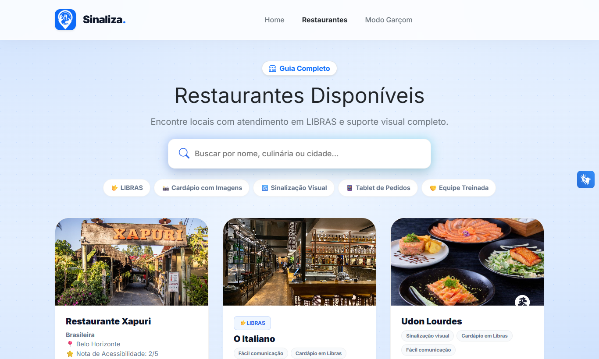
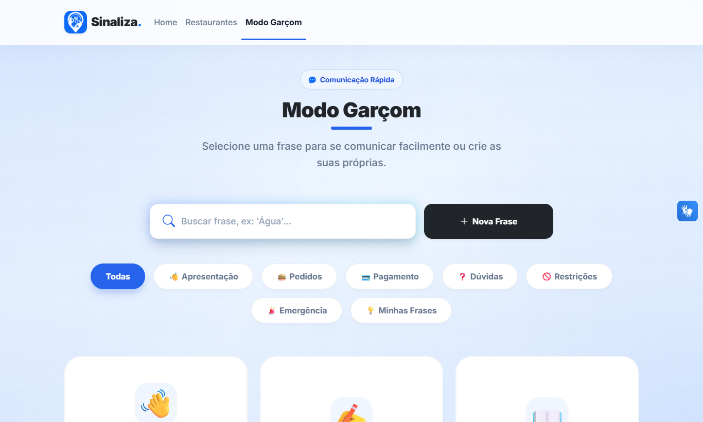
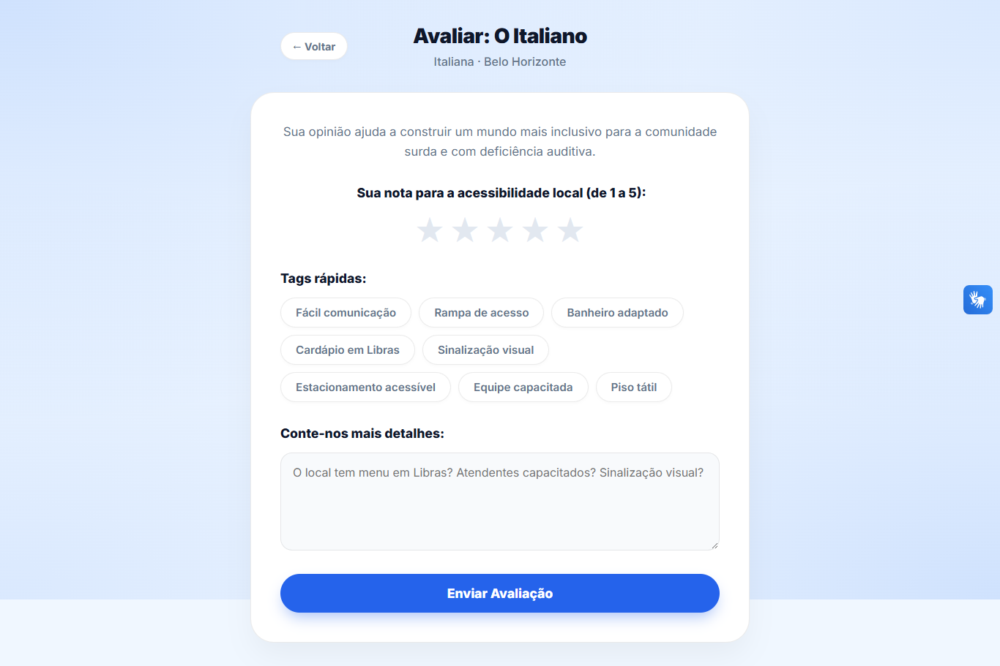
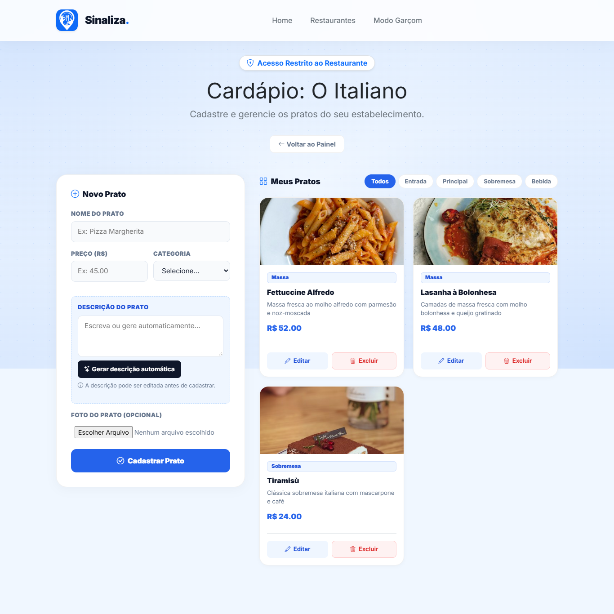
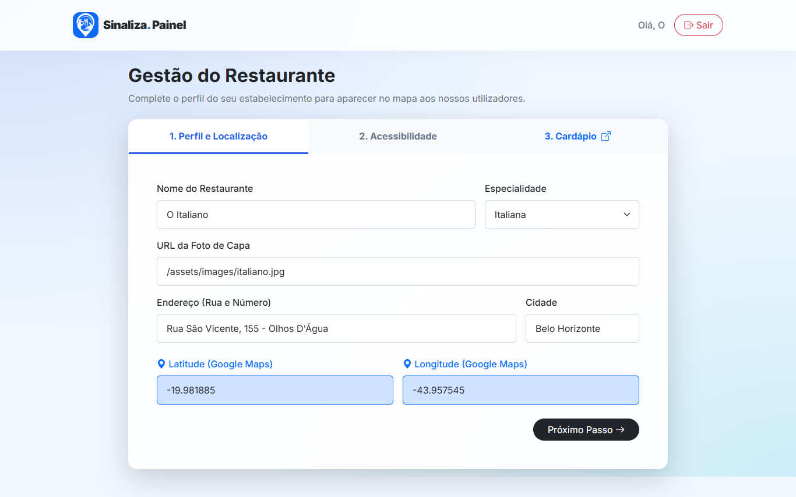
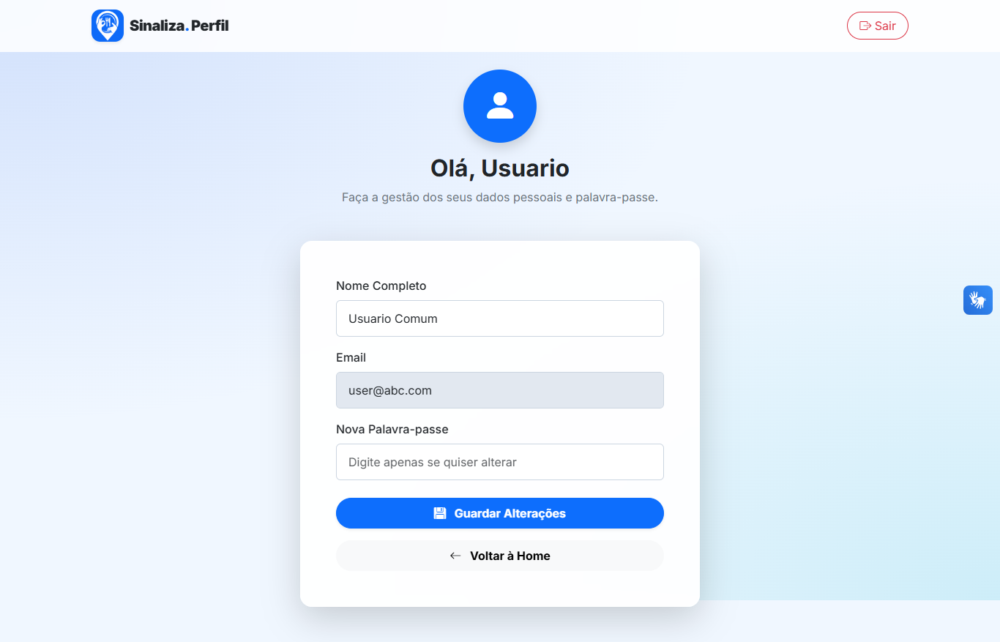
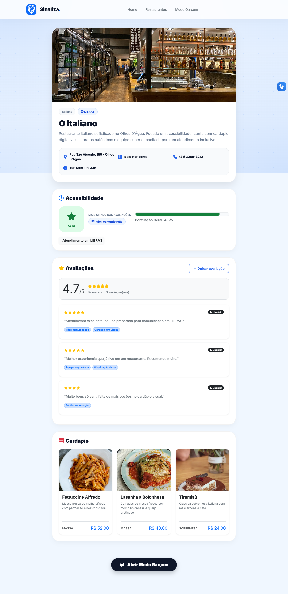

# 🤟 Sinaliza — Acessibilidade Gastronômica para Pessoas Surdas

O **Sinaliza** é uma plataforma web colaborativa que conecta pessoas com deficiência auditiva a restaurantes acessíveis. O frontend é feito em **HTML, CSS e JavaScript** (com Bootstrap e Leaflet); os dados vêm de uma **API REST com JSON Server**, que guarda tudo em um arquivo `db.json`.

Projeto desenvolvido em 2026/1 na disciplina **Trabalho Interdisciplinar: Desenvolvimento de Aplicações Web** (PUC Minas).

```text
HTML + CSS + JS (public/)  →  JSON Server REST API  →  db.json
```

## 🌐 Demonstração online

- **Site:** https://sinaliza-alpha.vercel.app/
- **Vídeo de apresentação:** [assista no Google Drive](https://drive.google.com/file/d/1tKagnHgEUMDz0UT9XIL0c_77RU1GvZgP/view?usp=sharing)

> ⚠️ Na versão online, a API roda como função serverless da Vercel e os dados ficam **em memória**. Cadastros, avaliações e a sessão de login valem enquanto a função estiver ativa e **podem sumir** em reinícios ou novos deploys. É uma versão de demonstração. Para persistência completa, rode o projeto localmente.

## 👥 Equipe

- **Diego Vitor Pinto Mariano Portella**
- **Gustavo Emanuel Gonçalves de Sousa**
- **Lucca Marinho Eterovik Tavares Pereira**
- **Nelson Buralli Dabes**
- **Rafael Mota Azevedo**
- **Victhor Gabriel Freire de Oliveira**

**Professores responsáveis:** Isabela Borlido Barcelos, Luiz Carlos da Silva e Ricardo Bruno da Cruz Costa.

---

## ✨ Funcionalidades

**Para quem usa o Sinaliza (clientes)**

- 🗺️ **Mapa interativo** com os restaurantes cadastrados.
- 📋 **Lista de restaurantes** com informações de acessibilidade e média das avaliações.
- 🔎 **Detalhes do restaurante:** endereço, horário, tipo de cozinha e o **checklist de acessibilidade** (Libras, cardápio com imagens, chat por texto, QR Code, tablet de pedidos etc.).
- ⭐ **Avaliações da comunidade:** formulário para avaliar a acessibilidade do local.
- 🍽️ **Cardápio visual simplificado**, com imagens e preços.
- 🧑‍🍳 **Modo Garçom:** comunicação assistida por categorias e frases prontas para facilitar o pedido e o atendimento na mesa.
- 👤 **Painel do cliente:** perfil e dados da conta.

**Para os restaurantes**

- 🔐 **Cadastro e login** de restaurantes e de clientes.
- 🏪 **Painel do restaurante:** dados do estabelecimento e checklist de acessibilidade.
- 💲 **Cadastro de pratos e preços** do cardápio.

---

## 🖼️ Telas

<p align="center">
  
</p>

<table>
  <tr>
    <td></td>
    <td></td>
  </tr>
  <tr>
    <td align="center"><b>Lista de restaurantes</b></td>
    <td align="center"><b>Modo Garçom</b></td>
  </tr>
  <tr>
    <td></td>
    <td></td>
  </tr>
  <tr>
    <td align="center"><b>Avaliação de acessibilidade</b></td>
    <td align="center"><b>Cardápio do restaurante</b></td>
  </tr>
  <tr>
    <td></td>
    <td></td>
  </tr>
  <tr>
    <td align="center"><b>Painel do restaurante</b></td>
    <td align="center"><b>Painel do cliente</b></td>
  </tr>
</table>

<table>
  <tr>
    <td></td>
    <td></td>
  </tr>
  <tr>
    <td align="center"><b>Detalhes, checklist e avaliações</b></td>
    <td align="center"><b>Versão para celular</b></td>
  </tr>
</table>

---

## 🧩 Módulos

Cada módulo fica em uma pasta de `codigo/public/modulos/`, com seu próprio HTML, CSS e JavaScript.

| Módulo | Função |
| --- | --- |
| `autenticacao` | Login e cadastro de clientes e restaurantes |
| `lista_restaurantes` | Lista os restaurantes com filtros e avaliações |
| `detalhes` | Página de um restaurante, com checklist e avaliações |
| `formulario_avaliacoes` | Formulário de avaliação de acessibilidade |
| `cardapio` | Cardápio visual do restaurante |
| `cadastro_pratos_precos` | Cadastro e edição de pratos e preços |
| `modo_garcom` | Comunicação assistida por categorias e frases |
| `painel_cliente` | Perfil do cliente |
| `painel_restaurante` | Painel de gestão do restaurante |

---

## 🛠️ Tecnologias

**Frontend**

- **HTML5, CSS3 e JavaScript** puros, com `fetch` para consumir a API.
- **[Bootstrap 5](https://getbootstrap.com/)** e **[Bootstrap Icons](https://icons.getbootstrap.com/)** para layout e ícones.
- **[Leaflet](https://leafletjs.com/)** para o mapa interativo.
- Fonte **Inter** (Google Fonts).

**Backend**

- **Node.js** com **[JSON Server](https://github.com/typicode/json-server)** (API REST e servidor de arquivos estáticos).
- **Express**, usado para publicar a API como função serverless na Vercel.

---

## 📁 Estrutura do projeto

```text
pmg-es-2026-1-ti1-0438200-g2-1/
├── codigo/                          # Código-fonte
│   ├── api/
│   │   └── index.js                 # API como função serverless (Vercel)
│   ├── db/
│   │   └── db.json                  # Banco de dados (JSON Server)
│   ├── public/                      # Frontend
│   │   ├── index.html               # Página inicial
│   │   ├── about.html               # Sobre o projeto
│   │   ├── home.css
│   │   ├── assets/                  # Estilos e imagens
│   │   └── modulos/                 # Um módulo por funcionalidade
│   │       ├── autenticacao/
│   │       ├── lista_restaurantes/
│   │       ├── detalhes/
│   │       ├── formulario_avaliacoes/
│   │       ├── cardapio/
│   │       ├── cadastro_pratos_precos/
│   │       ├── modo_garcom/
│   │       ├── painel_cliente/
│   │       └── painel_restaurante/
│   ├── index.js                     # Servidor local (JSON Server)
│   ├── vercel.json                  # Configuração de deploy
│   └── package.json
├── docs/                            # Documentação do projeto
│   └── images/                      # Personas, arquitetura, workflow e kanban
├── templates/                       # Templates de documentação da disciplina
├── CITATION.cff
└── README.md
```

---

## 🗄️ Modelo de dados (`db.json`)

O banco é um único arquivo JSON, com uma coleção por recurso:

| Coleção | Conteúdo |
| --- | --- |
| `usuarios` | Clientes e administradores (`nome`, `email`, `senha`, `tipo`) |
| `restaurantes` | Dados do local, localização (`lat`/`lng`), cardápio e **checklist de acessibilidade** (comunicação, tecnologia etc.) |
| `avaliacoes` | Avaliações de acessibilidade feitas pela comunidade |
| `cardapio` | Pratos e preços |
| `categorias_garcom` | Categorias do Modo Garçom |
| `frases_garcom` | Frases prontas do Modo Garçom |
| `sessao` | Usuário logado no momento (`sessao/atual`) |

---

## 🚀 Como executar

### 📋 Pré-requisitos

- [Node.js](https://nodejs.org/) (inclui o npm)
- [Git](https://git-scm.com/)

### 1. Clonar o repositório

```bash
git clone https://github.com/ICEI-PUC-Minas-PMGES-TI/pmg-es-2026-1-ti1-0438200-g2-1.git
cd pmg-es-2026-1-ti1-0438200-g2-1
```

### 2. Instalar e iniciar

```bash
cd codigo
npm install
npm start
```

Acesse **http://localhost:3000**. O mesmo servidor entrega o site (`public/`) e a API, então não há nada a configurar. Localmente os dados são gravados em `db/db.json`.

---

## 🌐 Endpoints da API

O JSON Server cria rotas REST para cada coleção do `db.json`:

| Método | Endpoint | Descrição |
| --- | --- | --- |
| `GET` | `/restaurantes` | Lista os restaurantes |
| `GET` | `/restaurantes/{id}` | Busca um restaurante |
| `POST` / `PUT` / `PATCH` / `DELETE` | `/restaurantes[/{id}]` | Cria, atualiza ou remove restaurantes |
| `GET` / `POST` | `/usuarios` | Lista ou cadastra usuários |
| `GET` / `POST` | `/avaliacoes` | Lista ou cria avaliações |
| `GET` / `POST` / `PATCH` / `DELETE` | `/cardapio[/{id}]` | Gerencia os pratos |
| `GET` | `/categorias_garcom` e `/frases_garcom` | Conteúdo do Modo Garçom |
| `GET` / `PATCH` | `/sessao` e `/sessao/atual` | Sessão do usuário logado |

O JSON Server aceita filtros por campo na URL, por exemplo `/avaliacoes?restauranteId=1`.

---

## ☁️ Publicar na internet (deploy)

O projeto inteiro (site e API) é publicado na **Vercel**:

```text
Vercel  →  public/ (site estático)  +  api/index.js (JSON Server serverless)
```

- O `vercel.json` serve a pasta `public/` e redireciona as rotas da API (`/usuarios`, `/restaurantes`, `/avaliacoes` etc.) para a função em `api/index.js`.
- O frontend usa **URLs relativas** (`/restaurantes`), então funciona igual no ambiente local e na Vercel.
- Como o disco da Vercel é somente leitura, a função carrega o `db.json` **em memória**. Os dados gravados são temporários.

**Para publicar** (dentro da pasta `codigo/`):

```bash
npx vercel login
npx vercel --prod
```

> Para ter persistência real em produção, o próximo passo seria trocar o `db.json` por um banco externo, como Supabase ou Upstash.

---

## 📚 Documentação

Os documentos do projeto (contexto, personas, requisitos, workflow, arquitetura e kanban) estão na pasta [`docs/`](docs/README.md).

---

## 🎓 Contexto acadêmico

Projeto desenvolvido no **Trabalho Interdisciplinar 1** do curso de Engenharia de Software da PUC Minas, com foco em desenvolvimento web (HTML, CSS e JavaScript), consumo de uma API REST com JSON Server e trabalho em equipe com metodologia ágil.
